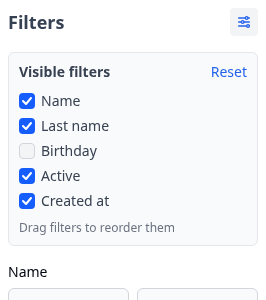
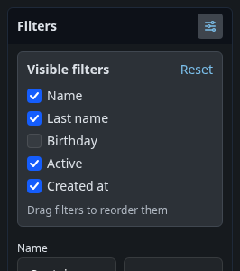

[](https://badge.fury.io/rb/active_admin_filters_visibility)
[](https://badge.fury.io/js/@activeadmin-plugins%2Factive_admin_filters_visibility)


# ActiveAdminFiltersVisibility

Lets an admin hide filters in the ActiveAdmin filters sidebar, and optionally reorder them. Useful when a page has many filters and each admin needs only some of them. The choice is saved per page in the browser's localStorage.




Version 2 supports ActiveAdmin 4 only. For ActiveAdmin 3, use version 1.x. See [Upgrading from 1.x](#upgrading-from-1x).

It works with stock ActiveAdmin 4 and with [active_admin_theme](https://github.com/activeadmin-plugins/active_admin_theme) 4, which wraps the filters sidebar in a panel: the toggle goes into the panel header.

## Install

```ruby
gem 'active_admin_filters_visibility'
```

### JavaScript

The gem pins the `active_admin_filters_visibility` module into `ActiveAdmin.importmap`, the import map ActiveAdmin pages render. ActiveAdmin pages then need to import it. Pick the route that matches your app:

- **ActiveAdmin with the `javascript_modules` setting** ([activeadmin/activeadmin#9148](https://github.com/activeadmin/activeadmin/pull/9148)): nothing to do. The gem adds itself to that setting.
- **active_admin_theme 4**: add the module to the theme's list in an initializer:

  ```ruby
  ActiveAdminTheme.javascripts += %w[active_admin_filters_visibility]
  ```

- **Otherwise**: copy `app/views/active_admin/_html_head.html.erb` from ActiveAdmin into your app and add this line after `javascript_importmap_tags`:

  ```erb
  <%= javascript_import_module_tag "active_admin_filters_visibility" %>
  ```

**jsbundling hosts** install the npm package and import it from the ActiveAdmin entry file:

```sh
npm install @activeadmin-plugins/active_admin_filters_visibility
```

```javascript
import "@activeadmin-plugins/active_admin_filters_visibility"
```

The module sets itself up on `#filters_sidebar_section` when the page loads.

### CSS

The styles are plain CSS. Import them into the Tailwind entry file that builds ActiveAdmin's stylesheet (usually `app/assets/stylesheets/active_admin.css`), after `@import "tailwindcss"`.

From the npm package:

```css
@import "@activeadmin-plugins/active_admin_filters_visibility/css";
```

Or from the installed gem. Its path differs between machines, so write it into a gitignored file before each CSS build instead of committing it:

```sh
echo "@import \"$(bundle show active_admin_filters_visibility)/app/assets/stylesheets/active_admin_filters_visibility.css\";" > app/assets/stylesheets/active_admin_filters_visibility.generated.css
```

```css
@import "./active_admin_filters_visibility.generated.css";
```

Dark mode follows the `.dark` class on `<html>`, as ActiveAdmin 4 does. With active_admin_theme the colors follow the theme's `--aat-*` custom properties.

## Configuration

Change `defaults` from a module that ActiveAdmin pages import. The plugin sets itself up on `DOMContentLoaded`, after every module has run, so the new values apply:

```javascript
import { defaults } from "active_admin_filters_visibility"

defaults.ordering = true
defaults.title = "Filtres visibles"
```

| Option | Default | Description |
| --- | --- | --- |
| `autoInit` | `true` | Set up the filters sidebar on page load. Set to `false` to call `setup()` yourself. |
| `selector` | `"#filters_sidebar_section"` | The sidebar section to set up on page load. |
| `storageKey` | `() => window.location.pathname` | The key the state is saved under. One key per page by default. |
| `ordering` | `false` | Let admins reorder filters by drag and drop. |
| `icon` | sliders SVG | HTML for the toggle button. |
| `buttonLabel` | `"Choose visible filters"` | The toggle's `aria-label` and tooltip. |
| `title` | `"Visible filters"` | The panel title. |
| `resetLabel` | `"Reset"` | The reset button text. |
| `orderHint` | `"Drag filters to reorder them"` | The hint shown when ordering is on. |

To set up a section by hand, pass options for that call only:

```javascript
import { defaults, setup } from "active_admin_filters_visibility"

defaults.autoInit = false
document.addEventListener("DOMContentLoaded", () => {
  setup(document.getElementById("filters_sidebar_section"), { ordering: true })
})
```

### Filters with a value stay visible

A hidden filter that has a value when the page loads stays visible, for example when an admin follows a link with filter params. Otherwise the list would be filtered by something the admin cannot see.

The plugin detects a value by the filter's type, which is a class on the filter wrapper (`select`, `string`, `date_range`, ...). Select and boolean filters count a selected option with a value. Every other type counts a filled text field or a checked box. To change that for one filter, give its wrapper a class and register a detector for it:

```ruby
filter :id, wrapper_html: { class: 'customized-id' }
```

```javascript
import { registerFilterType } from "active_admin_filters_visibility"

// Return true when the filter has a value. "1" counts as empty here.
registerFilterType("customized-id", (wrapper) => {
  const value = wrapper.querySelector("input:not([type=hidden])").value
  return value !== "" && value !== "1"
})
```

### Saving state

The state is saved in localStorage under `active_admin_filters_visibility:<storageKey>`, as JSON: `{"hidden": ["q_name_input"], "order": [...]}`. Filters are identified by the id of their wrapper (`q_<attribute>_input`). To save it elsewhere, replace the `storage` methods:

```javascript
import { storage } from "active_admin_filters_visibility"

storage.load = (key) => myStore.read(key) || {}
storage.save = (key, state) => myStore.write(key, state)
storage.clear = (key) => myStore.delete(key)
```

### Test hooks

The markup the plugin adds carries `data-*` attributes, so tests do not depend on CSS classes:

- `data-filters-visibility` on the sidebar section once it is set up.
- `data-filters-visibility-header` on the header that holds the toggle.
- `data-filters-visibility-toggle` on the toggle button. It also has `aria-expanded`, and `data-filters-visibility-active` while any filter is hidden.
- `data-filters-visibility-panel` on the panel.
- `data-filters-visibility-item="<wrapper id>"` on each row and `data-filters-visibility-checkbox="<wrapper id>"` on its checkbox.
- `data-filters-visibility-reset` on the reset button.
- `data-filters-visibility-hidden` on a hidden filter wrapper.

## Upgrading from 1.x

- ActiveAdmin 4 only. ActiveAdmin 3 apps stay on 1.x.
- No jQuery and no Sprockets. The asset is an ES module loaded through ActiveAdmin's import map or the npm package, and it sets itself up: remove the `$('#filters_sidebar_section').activeAdminFiltersVisibility()` call.
- Options moved from the jQuery call to `defaults`. `iconClass`, `iconStyle` and `skipDefaultCss` are gone: style the toggle with CSS, or leave the stylesheet out. `sidebarUniqId` is now `storageKey`. `$.fn.activeAdminFiltersVisibility.registerFilterType` and `.storage` are now the `registerFilterType` export and the `storage` object.
- The styles are a stylesheet you import into the ActiveAdmin Tailwind build. They are no longer injected at runtime.
- Saved state uses a new key and format, and identifies filters by wrapper id instead of label text. Hidden filters and custom orders saved by 1.x are not carried over.
- Reset is always shown and no longer reloads the page.
- Filter type detectors are keyed by any class on the wrapper, such as Formtastic's type (`select`) or a class you set, instead of a `filter_<type>` class.

## Development

```sh
bundle exec rspec
BUNDLE_GEMFILE=gemfiles/active_admin_theme.gemfile bundle exec rspec
```

The second run uses active_admin_theme from git. Set `ACTIVE_ADMIN_THEME_PATH` to use a local checkout. The specs build the dummy app's stylesheet with the standalone Tailwind CLI from `tailwindcss-ruby`.
